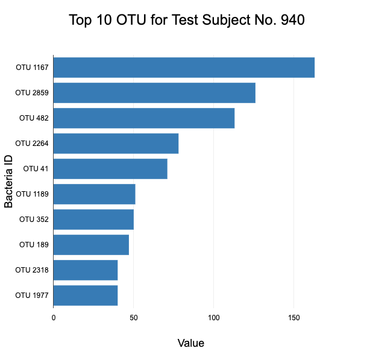
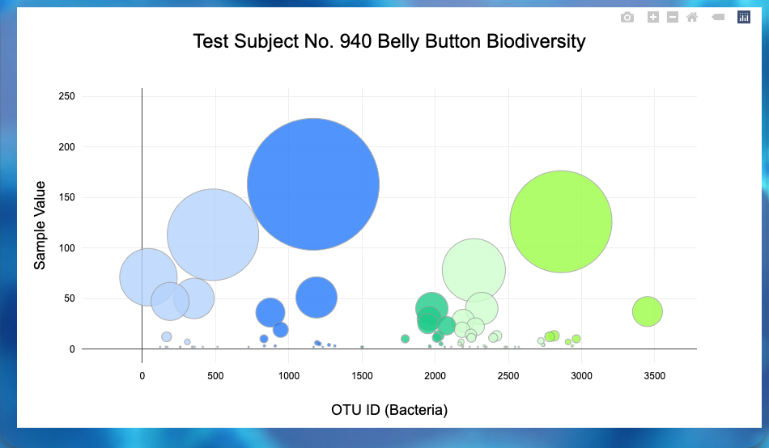
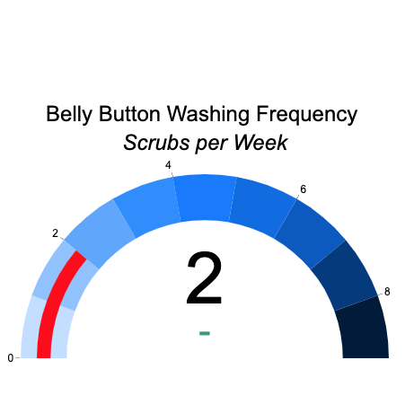

# Belly Button Biodiversity Dashboard


An interactive dashboard for exploring the microbes that live in human belly buttons. Pick any of **153 test subjects** to see their demographics, their most abundant bacteria, and how often they wash.

🔗 **[Live demo](https://ermiasgelaye.github.io/plotly-Challenge/)**


## Background

The [Belly Button Biodiversity](https://doi.org/10.1371/journal.pone.0047712) project, which began in January 2011, catalogued the microbes colonizing people's navels. A small handful of microbial species, called *operational taxonomic units* (OTUs), were present in more than 70% of people, while the rest were relatively rare.

## Dashboard panels

| Panel | What it shows |
|---|---|
| **Test Subject ID** | Dropdown of all 153 subjects. Every panel updates on change. |
| **Demographic Info** | The subject's ethnicity, gender, age, location, belly-button type and washing frequency |
| **Bubble chart** | Every OTU found in the subject. x = OTU ID, y and size = sample value, color = OTU ID, hover = bacteria names |
| **Bar chart** | The subject's 10 most abundant OTUs, with bacteria names on hover |
| **Gauge** | Belly-button washing frequency, in scrubs per week (0–9) |


| Bar chart | Bubble chart | Gauge |
|---|---|---|
|  |  |  |

## How it works

[`static/js/app.js`](static/js/app.js) fetches [`data/samples.json`](data/samples.json) **once** with `d3.json`, fills the dropdown, and redraws all four panels with Plotly whenever `optionChanged(id)` fires. The dataset has three parts:

- `names`: the subject IDs
- `metadata`: one demographics record per subject
- `samples`: per subject, the `otu_ids`, `sample_values` and `otu_labels`, sorted by abundance

## Run locally

Browsers block `fetch` from `file://` URLs, so serve the folder over HTTP:

```bash
git clone https://github.com/ermiasgelaye/plotly-Challenge.git
cd plotly-Challenge
python -m http.server 8000      # then open http://localhost:8000
```

## Project structure

```
plotly-Challenge/
├── index.html          # page layout (Bootstrap 3)
├── style.css
├── data/samples.json   # dataset
├── static/
│   ├── js/app.js       # data loading and charts
│   └── img/            # page images
└── Images/             # README screenshots
```

## Data source

Hulcr J, Latimer AM, Henley JB, Rountree NR, Fierer N, Lucky A, et al. (2012). *A Jungle in There: Bacteria in Belly Buttons are Highly Diverse, but Predictable.* PLoS ONE 7(11): e47712. [doi:10.1371/journal.pone.0047712](https://doi.org/10.1371/journal.pone.0047712)

## Author

**Ermias Gelaye** · [Portfolio](https://ermiasgelaye.github.io) · [GitHub](https://github.com/ermiasgelaye)
